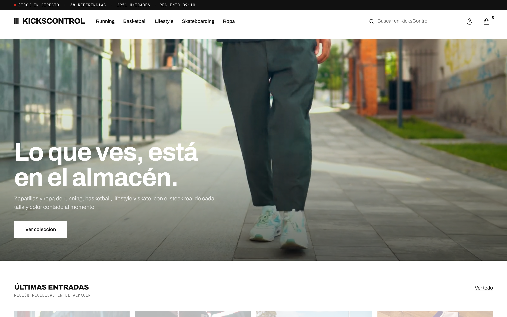

# KicksControl — E-Commerce & Smart Backoffice

> Portfolio project by **Juan David Gil** (DAW + Systems Engineering @ UPM | ex Shift Leader @ Foot Locker)  
> Full-stack sneaker store with three faces on **one shared stock per size and colour**: an online shop, a physical-store app with a till, and a retail backoffice — built on real shop-floor expertise.



---

## Tech Stack

| Layer | Technology |
|---|---|
| **Backend** | Java 17 · Spring Boot 3.5 · Spring Security + JWT · Hibernate/JPA |
| **Database** | PostgreSQL 16 · ENUMs · CHECK constraints · composite indexes · analytics views |
| **Frontend** | Next.js 16 (App Router) · React 19 · TypeScript strict · TanStack Query · Recharts |
| **Styling** | Tailwind CSS 4 |
| **Infrastructure** | Docker Compose (profiles) · Multi-stage Dockerfiles · Makefile |
| **API Docs** | Springdoc OpenAPI 2.6 (Swagger UI) |

---

## Features

### Online shop (`/`)
- **Stockroom identity** — white Kith/SVD-style base with a shoebox end label (barcode, reference, units) on every product and a live stock strip above the header
- **Bespoke category pages** for Running, Basketball, Lifestyle and Skateboarding
- **Catalog** with dynamic filters (brand, category, size, color, gender, in-stock only) stored in URL — bookmarkeable and shareable
- **Product detail** with color/size variant selector and live stock status
- **Shopping cart** (persistent, server-side via TanStack Query)
- **Transactional checkout** with 3-layer concurrency protection (optimistic lock → pessimistic SELECT FOR UPDATE → DB CHECK constraint)
- **Order history** with status badges and order detail

### Physical store (`/tienda`)
- **Store front** for the shop's own devices: Catalog (open), Till and Stock (staff sign-in, then back to the screen asked for)
- **Store catalog** — every model with the units left per size and colour
- **Till (POS)** — scan a SKU or search a model, ticket capped at the stock on the shelf, card or cash with change, receipt and today's takings
- A till sale is born `DELIVERED`, is attributed to the member of staff and shows in the backoffice tagged *Tienda*

### Backoffice (ADMIN / SHIFT_LEADER)
- **Inventory** — one row per model with thumbnail and low/out-of-stock flags, expanding into a **size × colour stock matrix**; tap a box to adjust it
- **Traceable stock adjustments** — delta + reason (RECEPCIÓN / DEVOLUCIÓN / AJUSTE / MERMA), sign rules enforced server-side; every adjustment is logged in `stock_movements` with its author and the stock left, and shown as the box's history
- **Restock list** — variants at ≤ 5 units, emptiest first, one tap to adjust
- **Order management** — status tabs with counts, pagination, item breakdown, channel (online / store), inline status transitions
- **KPI Dashboard** — configurable date range + granularity:
  - Revenue, orders, avg ticket, units sold
  - **Sell-Through Rate** — `unitsSold * 100 / (unitsSold + currentStock)`
  - **Days of Coverage** — `currentStock / avgDailySales`
  - **Shrinkage Rate** — units written off as MERMA / (units sold + units written off)
  - Revenue chart, best sellers, orders by status
  - Sales = confirmed, shipped or delivered orders, from the web and the till

---

## Quick Start

### Prerequisites
- Docker Desktop
- Java 17+ (for local backend dev only)
- Node.js 20+ (for local frontend dev only)

### Option 1 — Full stack in Docker

```bash
cp .env.example .env        # set JWT_SECRET and DB credentials
make full                   # builds + starts everything
```

- Frontend: http://localhost:3000  
- API: http://localhost:8080  
- Swagger UI: http://localhost:8080/swagger-ui.html

### Option 2 — Local development (hot reload)

```bash
# Terminal 1 — database only
make db

# Terminal 2 — backend with hot reload
make dev

# Terminal 3 — frontend
cd kickscontrol-frontend
npm install
npm run dev
```

### Seed data

```bash
make seed    # loads the catalog: 38 products (25 footwear, 13 apparel) with their variants
```

Seed accounts:

| Role | Email | Password |
|---|---|---|
| Admin | `admin@kickscontrol.com` | `Admin1234!` |
| Shift Leader | `shiftleader@kickscontrol.com` | `Admin1234!` |
| Customer | `cliente@kickscontrol.com` | `User1234!` |

The physical store opens at `/tienda`.

> **Upgrading an existing database?** `schema.sql` only runs when the volume is created. Bring an older database up to date with the idempotent script in `kickscontrol-backend/src/main/resources/db/migrations/2026-10-tienda-fisica.sql`:
>
> ```bash
> docker exec -i kickscontrol-db psql -U kickscontrol_user -d kickscontrol < kickscontrol-backend/src/main/resources/db/migrations/2026-10-tienda-fisica.sql
> ```

---

## Project Structure

```
kickscontrol/
├── kickscontrol-backend/          Spring Boot API
│   └── src/main/java/
│       ├── controller/            REST controllers
│       ├── service/               Business logic
│       ├── repository/            JPA repositories + Specifications
│       ├── entity/                JPA entities
│       ├── dto/                   Request & response DTOs
│       ├── security/              JWT filter + config
│       └── exception/             Global error handler
├── kickscontrol-frontend/         Next.js 16 App Router
│   ├── app/
│   │   ├── (store)/               Online shop pages
│   │   ├── tienda/                Physical store: front, catalog, till, stock
│   │   ├── backoffice/            Protected admin pages
│   │   ├── login/                 Auth pages
│   │   └── register/
│   ├── components/
│   │   ├── tienda/                StoreShell, Till, StoreCatalog, ProductSizes
│   │   ├── backoffice/            KpiCard, charts, StockAdjustModal, LowStockPanel
│   │   ├── cart/                  CartDrawer
│   │   ├── catalog/               FilterPanel, ProductGrid
│   │   └── layout/                Header, Footer
│   ├── context/                   AuthContext, CartContext
│   └── lib/                       apiClient, analytics, products, admin, cart
├── docker-compose.yml             profiles: db | full
├── docs/capturas/                 portfolio screenshots (scripts/capturas-portfolio.mjs)
├── Makefile                       dev workflow commands
├── PORTFOLIO.md                   portfolio write-up (Spanish)
└── ARQUITECTURA.md                technical decisions document
```

---

## API Reference

Full interactive docs at `/swagger-ui.html` when the backend is running.

| Group | Endpoints |
|---|---|
| Auth | `POST /api/auth/register` · `POST /api/auth/login` |
| Catalog | `GET /api/products` · `GET /api/products/{id}` · `/brands` · `/categories` |
| Cart | `GET/POST /api/cart` · `PUT/DELETE /api/cart/items/{id}` |
| Orders | `POST /api/orders/checkout` · `GET /api/orders` · `GET /api/orders/{id}` |
| Store (till) | `POST /api/store/sales` · `GET /api/store/sales/today` · `GET /api/store/variants/{sku}` |
| Admin — Products | `GET/POST /api/admin/products` · `PUT/DELETE /api/admin/products/{id}` |
| Admin — Inventory | `PATCH /api/admin/variants/{id}/stock` · `GET /api/admin/variants/{id}/movements` · `GET /api/admin/products/inventory/alerts` |
| Admin — Orders | `GET /api/admin/orders` · `PATCH /api/admin/orders/{id}/status` |
| Analytics | `GET /api/admin/analytics/summary` · `/revenue-chart` · `/top-sellers` · `/orders-by-status` |

---

## Checkout Concurrency (3-layer defense)

Concurrent purchases of the last unit are handled at three levels:

1. **`@Version` (optimistic lock)** — `ProductVariant` has a `version` column. Two concurrent transactions reading the same version will cause one to throw `OptimisticLockException` on flush.
2. **`SELECT FOR UPDATE` (pessimistic lock)** — `findByIdForUpdate()` in the repository acquires a row-level lock before decrementing stock.
3. **`CHECK (stock_quantity >= 0)` (DB constraint)** — last line of defense; raises a constraint violation if anything slips through.

All three layers fire within a single `@Transactional` method that also calls `clearCart()` atomically. The till's `storeSale()` takes stock through the same private method (`takeFromShelf`), so a web customer and the till can never both sell the last unit.

---

## Retail KPIs

Metrics come from real-world retail operations (Foot Locker Shift Leader experience):

| KPI | Formula | Why it matters |
|---|---|---|
| Sell-Through Rate | `unitsSold × 100 / (unitsSold + currentStock)` | Measures how efficiently inventory converts to sales |
| Days of Coverage | `currentStock / avgDailySales` | Predicts when stock will run out |
| Shrinkage Rate | `mermaUnits × 100 / (unitsSold + mermaUnits)` | Share of the units that left the shelf as loss (theft, damage, error) rather than sales |
| Avg Ticket | `totalRevenue / totalOrders` | Key profitability indicator per transaction |

---

## Screenshots

23 screenshots of the online shop, backoffice and physical store in [`docs/capturas/`](docs/capturas/), with a gallery in [PORTFOLIO.md](PORTFOLIO.md#capturas). Regenerate them with:

```bash
BASE=http://localhost:3000 node kickscontrol-frontend/scripts/capturas-portfolio.mjs   # add --con-venta to ring up one real till sale
```

---

## Development Commands

```bash
make db           # start PostgreSQL only
make dev          # start DB + backend (hot reload)
make full         # start full stack in Docker
make build        # build Docker images
make test         # run backend tests (mvn verify)
make seed         # reload seed data
make logs         # tail all logs
make stop         # stop containers (keep data)
make clean        # stop + delete volumes
```

---

## Git Flow

```
main          ← production releases (tagged)
develop       ← integration branch
feature/*     ← sprint work (merged with --no-ff)
```

Commits follow [Conventional Commits](https://www.conventionalcommits.org/):  
`feat:`, `fix:`, `refactor:`, `docs:`, `chore:`

---

## Architecture Decisions

See [ARQUITECTURA.md](ARQUITECTURA.md) for a detailed explanation of every major technical decision and its rationale — written for portfolio defense and technical interviews.
